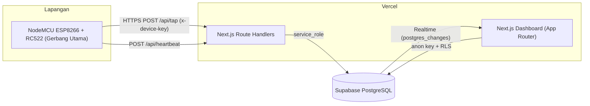
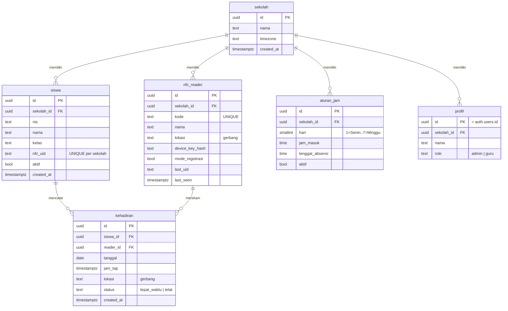

# PRD — AXENTA (Automated Experience for Entry and Attendance)

> **Versi:** 1.0 · **Tanggal:** 16 November 2026 · **Status:** Draft
> **Klien awal:** SDI AL-Irsyadiah

---

## 1. Ringkasan Produk

**AXENTA (Automated Experience for Entry and Attendance)** adalah sistem absensi siswa berbasis **NFC** di **Gerbang Utama Sekolah** yang mencatat kehadiran serta **ketepatan waktu** siswa secara otomatis dan real-time.

Data dikirim oleh perangkat **NodeMCU ESP8266 + NFC Reader (RC522) + LCD I2C + ESP32-CAM** di Gerbang Utama ke backend **Next.js**, disimpan di **Supabase (PostgreSQL)**, dan ditampilkan secara **real-time** pada dashboard web untuk guru/admin sekolah.

## 2. Latar Belakang & Masalah

| Masalah | Dampak |
|---|---|
| Absensi manual (buku/kertas) lambat & rawan manipulasi | Data tidak akurat, sulit direkap |
| Sekolah tidak punya data keterlambatan yang terstruktur | Tidak bisa melakukan pembinaan dini |
| Pendidikan karakter peduli lingkungan sulit diukur | Tidak ada indikator kuantitatif |
| Rekap bulanan memakan waktu guru | Beban administratif tinggi |

## 3. Tujuan & Metrik Keberhasilan

| Tujuan | KPI |
|---|---|
| Absensi otomatis & cepat | Waktu tap → tercatat di dashboard **< 2 detik** |
| Akurasi data | ≥ 99% tap tercatat tanpa duplikasi |
| Mengurangi beban rekap | Export rekap bulanan ke Excel **1 klik** |
| Monitoring ketepatan waktu | Persentase tap tepat waktu vs terlambat di Gerbang Utama tersedia harian & mingguan |
| Pembinaan siswa telat | Daftar siswa telat ≥ 3 hari/bulan otomatis |

## 4. Pengguna (Persona)

| Persona | Kebutuhan |
|---|---|
| **Admin / Operator Sekolah** | Kelola data siswa, aturan jam, perangkat, reset data |
| **Guru / Wali Kelas** | Pantau kehadiran & rekap kelas, export laporan |
| **Kepala Sekolah** | Lihat ringkasan & tren kehadiran siswa |
| **Siswa** (pengguna perangkat) | Tap kartu NFC di Gerbang Utama Sekolah, mendapat feedback cepat (LCD/buzzer) |

## 5. Tech Stack

| Layer | Teknologi |
|---|---|
| Frontend & Backend | **Next.js 14+ (App Router)**, TypeScript, React Server Components, Route Handlers (`/app/api`) |
| UI | Tailwind CSS, shadcn/ui, lucide-react (ikon), Recharts (grafik) |
| Database & Auth | **Supabase** (PostgreSQL, Supabase Auth, Realtime, Row Level Security) |
| Client DB | `@supabase/supabase-js`, `@supabase/ssr` |
| Excel | `xlsx` (SheetJS) untuk import/export |
| Validasi | Zod |
| Hardware | **NodeMCU ESP8266** (kompatibel ESP32) + **NFC Reader MFRC522 (13.56 MHz)** / PN532, buzzer, LED RGB, (opsional) OLED 0.96" |
| Firmware | Arduino framework (Arduino IDE / PlatformIO), library `MFRC522`, `ESP8266WiFi`, `ESP8266HTTPClient`, `ArduinoJson`, `NTPClient` |
| Deployment | Vercel (Next.js) + Supabase Cloud |

## 6. Arsitektur Sistem



**Alur tap:**
1. Siswa menempelkan kartu NFC → ESP8266 membaca **UID** kartu.
2. ESP8266 mengirim `POST /api/tap` berisi `uid`, `reader_code`, `timestamp` dengan header `x-device-key`.
3. Server memvalidasi device key → mencari siswa berdasarkan `nfc_uid` → mengambil aturan jam hari tersebut → menentukan status **Tepat Waktu / Telat** → menyimpan ke tabel `kehadiran` (1 record per siswa per hari; tap pertama yang dihitung).
4. Server merespons JSON (`ok`, `nama`, `status`) → ESP8266 memberi feedback (buzzer + LED hijau/kuning/merah).
5. Dashboard menerima event via **Supabase Realtime** dan memperbarui UI tanpa refresh.

## 7. Fitur & Kebutuhan Fungsional

### 7.1 Autentikasi
- **F-AUTH-1** Login email + password (Supabase Auth).
- **F-AUTH-2** Semua halaman dashboard dilindungi middleware; redirect ke `/login` jika belum login.
- **F-AUTH-3** Logout dari tombol di footer sidebar.
- **F-AUTH-4** Role: `admin`, `guru` (guru tidak bisa reset database & ubah aturan jam).

### 7.2 Layout Global
- **Sidebar** (navy gelap): logo AXENTA + subjudul (*Automated Experience for Entry and Attendance*), menu (Dashboard, Rekap Kehadiran, Data Siswa, Aturan Jam Sekolah, Pengaturan), indikator **status NFC Reader** (Online/Offline), profil user + tombol logout.
- **Topbar**: badge nama sekolah (contoh: *SDI AL-Irsyadiah*), nama & role user + avatar inisial.
- Status NFC Reader dihitung dari `last_seen` perangkat: **Online** jika heartbeat < 60 detik terakhir.

### 7.3 Dashboard Kehadiran (`/dashboard`)
| ID | Kebutuhan |
|---|---|
| F-DB-1 | **Kartu Total Siswa Terpantau** (badge "Aktif") — jumlah siswa aktif. |
| F-DB-2 | **Kartu Rata-rata Ketepatan Waktu** (%) — badge "Perlu Perhatian" bila < 80%, "Baik" bila ≥ 80%. |
| F-DB-3 | **Kartu Siswa Sering Telat** (badge "≥3 hari") — jumlah siswa telat ≥ 3 hari di bulan ini. |
| F-DB-4 | **Kartu Hari Sekolah Bulan Ini** (badge "Sen–Jum") — jumlah hari efektif berdasarkan aturan jam aktif. |
| F-DB-5 | **Distribusi Kehadiran** — donut chart bulan berjalan: Tepat Waktu, Telat, Absen (% + total di tengah). |
| F-DB-6 | **Aktivitas Terbaru** — tabel 10 tap terakhir (Siswa, Kelas, Lokasi & Bobot, Jam Tap, Tanggal, Status), real-time, link "Lihat Semua Data". |
| F-DB-7 | **Ringkasan Tap Gerbang Utama Hari Ini** — jumlah & % siswa tap Tepat Waktu vs Terlambat di Gerbang Utama, dengan progress bar. |
| F-DB-8 | **Box Info Gerbang Utama** — informasi pembacaan perangkat `RDR-GERBANG-01`. |
| F-DB-9 | **Siswa Paling Tepat Waktu** — top 10 siswa berdasarkan kehadiran tepat waktu bulan ini; empty state "Belum ada data absensi siswa." |
| F-DB-10 | **Tren Kehadiran Mingguan (Gerbang Utama)** — grouped bar chart 5 hari sekolah terakhir (Tepat Waktu vs Telat), dropdown urutan "Tanggal (Lama → Baru)" / "(Baru → Lama)". |

### 7.4 Rekap Kehadiran (`/rekap`)
| ID | Kebutuhan |
|---|---|
| F-RK-1 | Filter **bulan** (month picker) dan **kelas** ("Semua Kelas" / per kelas). |
| F-RK-2 | **Tabel Rekap** — baris: No, Nama Siswa; kolom: setiap hari sekolah (hari + tanggal); kolom akhir **% TW** (persentase tepat waktu). Header tabel menampilkan "N siswa • M hari sekolah". |
| F-RK-3 | Isi sel: ikon/kode status (✓ Tepat, T Telat, A Absen, `-` belum ada data/hari mendatang), tooltip jam tap & lokasi. |
| F-RK-4 | Tabel scroll horizontal, kolom nama sticky. |
| F-RK-5 | Klik nama siswa → drawer detail kehadiran siswa bulan tersebut. |
| F-RK-6 | **Export Excel** — rekap sesuai filter (`Rekap_Kehadiran_<Kelas>_<Bulan>.xlsx`). |
| F-RK-7 | **Hapus Kehadiran** — hapus data kehadiran bulan terpilih (admin, dengan dialog konfirmasi). |
| F-RK-8 | **Grafik Ketepatan Waktu** — tab "Grafik Harian" (stacked bar Tepat Waktu vs Telat per hari) dan "Detail Jam Tap" (scatter/histogram jam tap). |

### 7.5 Data Siswa (`/siswa`)
| ID | Kebutuhan |
|---|---|
| F-SW-1 | Grid kartu siswa: avatar inisial, nama, kelas, NFC UID. |
| F-SW-2 | Pencarian nama atau kelas (debounce 300 ms); teks "Menampilkan **N** siswa". |
| F-SW-3 | **Tambah Siswa** — modal form: nama, NIS (opsional), kelas, NFC UID (input manual atau tombol **"Scan Kartu"** yang mengambil UID tap terakhir dari reader dalam mode registrasi). |
| F-SW-4 | Edit & nonaktifkan/hapus siswa (klik kartu → modal detail). |
| F-SW-5 | **Template** — unduh template Excel (`nama, nis, kelas, nfc_uid`). |
| F-SW-6 | **Import Excel** — upload, preview, validasi (UID unik, kolom wajib), lalu simpan bulk (upsert by `nfc_uid`). |
| F-SW-7 | **Export Siswa** — unduh seluruh data siswa ke Excel. |
| F-SW-8 | NFC UID wajib unik per sekolah. |

### 7.6 Aturan Jam Sekolah (`/aturan-jam`)
| ID | Kebutuhan |
|---|---|
| F-AJ-1 | Tabel 7 hari (Senin–Minggu) dengan **Jam Masuk** dan **Tenggat Absensi** (select jam 00–23 & menit 00–59, step 5). |
| F-AJ-2 | Toggle **hari aktif/libur** per hari (dipakai untuk menghitung hari efektif). |
| F-AJ-3 | Validasi: tenggat ≥ jam masuk. |
| F-AJ-4 | Tombol **Simpan Perubahan**; perubahan berlaku pada tap berikutnya secara real-time. |
| F-AJ-5 | Aturan: tap ≤ tenggat → **Tepat Waktu**; tap > tenggat → **Telat** (teks "Telat" berwarna merah). |

### 7.7 Pengaturan Sistem (`/pengaturan`)
| ID | Kebutuhan |
|---|---|
| F-PG-1 | **Manajemen Basis Data** — kartu "Pembersihan Data Kehadiran (Reset Database)" (zona bahaya). |
| F-PG-2 | Opsi hapus **per bulan** atau **Reset Total** (setara `TRUNCATE TABLE kehadiran`), dengan konfirmasi mengetik kata `HAPUS`. Data master siswa & sekolah tidak terpengaruh. |
| F-PG-3 | **Status Koneksi Supabase** — indikator koneksi aktif & sinkronisasi tabel Siswa, Kehadiran, NfcReader, Sekolah. |
| F-PG-4 | **Manajemen NFC Reader** — daftar perangkat Gerbang Utama (kode, lokasi Gerbang Utama, status, last seen), tambah reader & generate device key. |
| F-PG-5 | **Profil Sekolah** — nama sekolah, zona waktu (default `Asia/Jakarta`). |

### 7.8 Firmware NodeMCU ESP8266
| ID | Kebutuhan |
|---|---|
| F-HW-1 | Koneksi Wi-Fi dengan auto-reconnect (WiFiManager untuk konfigurasi SSID via captive portal). |
| F-HW-2 | Baca UID kartu MIFARE (RC522 via SPI), format HEX uppercase (contoh `8159FF7B`). |
| F-HW-3 | Anti double-tap: abaikan UID yang sama dalam 5 detik. |
| F-HW-4 | Kirim `POST /api/tap` (HTTPS) dengan header `x-device-key`. |
| F-HW-5 | Feedback: buzzer 1x + LED hijau (Tepat Waktu), 2x + LED kuning (Telat), panjang + LED merah (kartu tidak terdaftar/error). |
| F-HW-6 | Heartbeat `POST /api/heartbeat` setiap 30 detik. |
| F-HW-7 | Sinkronisasi waktu via NTP (`pool.ntp.org`, GMT+7). |
| F-HW-8 | **Offline buffer**: bila gagal kirim, simpan tap ke LittleFS (maks. 200 record) dan kirim ulang saat online. |
| F-HW-9 | (Opsional) OLED menampilkan nama siswa & status. |

**Wiring RC522 → NodeMCU ESP8266**

| RC522 | NodeMCU |
|---|---|
| SDA (SS) | D8 (GPIO15) |
| SCK | D5 (GPIO14) |
| MOSI | D7 (GPIO13) |
| MISO | D6 (GPIO12) |
| RST | D3 (GPIO0) |
| 3.3V | 3V3 |
| GND | GND |
| Buzzer | D1 (GPIO5) |
| LED Hijau / Merah | D2 (GPIO4) / D0 (GPIO16) |

## 8. Model Data (Supabase)



**Catatan:**
- Constraint `UNIQUE (siswa_id, tanggal)` pada `kehadiran` → hanya tap pertama per hari yang dihitung.
- Status **Absen** tidak disimpan; dihitung saat query (hari aktif tanpa record kehadiran).
- Index: `kehadiran(tanggal)`, `kehadiran(siswa_id, tanggal)`, `siswa(sekolah_id, nfc_uid)`.
- **RLS**: user hanya dapat membaca/menulis data dengan `sekolah_id` yang sama dengan profilnya; aksi hapus kehadiran & ubah aturan jam hanya `role = 'admin'`.
- **Realtime** diaktifkan untuk tabel `kehadiran` dan `nfc_reader`.
- View/RPC: `v_rekap_bulanan`, `rpc_statistik_dashboard(bulan)`, `rpc_leaderboard_eco(bulan)`, `rpc_reset_kehadiran(bulan nullable)`.

## 9. Spesifikasi API (Next.js Route Handlers)

| Method | Endpoint | Auth | Deskripsi |
|---|---|---|---|
| POST | `/api/tap` | `x-device-key` | Catat tap NFC |
| POST | `/api/heartbeat` | `x-device-key` | Update `last_seen` reader |
| GET | `/api/rekap/export?bulan=2026-11&kelas=4A` | Session | Unduh Excel rekap |
| GET | `/api/siswa/export` | Session | Unduh Excel siswa |
| GET | `/api/siswa/template` | Session | Unduh template |
| POST | `/api/siswa/import` | Session (admin) | Import Excel |
| DELETE | `/api/kehadiran?bulan=2026-11` | Session (admin) | Hapus per bulan / total bila tanpa param |

**Contoh `POST /api/tap`**
```json
// Request
{ "uid": "8159FF7B", "reader": "RDR-GERBANG-01", "ts": "2026-11-16T06:45:12+07:00" }

// Response 200
{ "ok": true, "nama": "Ahmad Rasyid", "status": "tepat_waktu", "lokasi": "gerbang" }

// Response 200 (sudah tap hari ini)
{ "ok": true, "duplicate": true, "nama": "Ahmad Rasyid" }

// Response 404
{ "ok": false, "error": "UID_NOT_REGISTERED" }
```
Jika reader dalam `mode_registrasi = true`, tap tidak dicatat sebagai kehadiran, hanya menyimpan `last_uid` untuk form Tambah Siswa.

## 10. Logika Bisnis

- **Status:** `jam_tap (lokal) <= tenggat_absensi` → `tepat_waktu`, selain itu `telat`. Tap pada hari non-aktif ditolak (`NOT_SCHOOL_DAY`).
- **% Ketepatan Waktu (TW) siswa** = jumlah tepat waktu ÷ jumlah hari sekolah yang sudah berlalu × 100.
- **Rata-rata ketepatan waktu** = rata-rata % TW seluruh siswa aktif.
- **Siswa sering telat** = siswa dengan jumlah telat ≥ 3 di bulan berjalan.
- **Hari sekolah bulan ini** = jumlah tanggal di bulan berjalan yang harinya `aktif` di `aturan_jam`.

## 11. Kebutuhan Non-Fungsional

| Aspek | Target |
|---|---|
| Performa | Dashboard LCP < 2.5 s; API tap < 500 ms |
| Real-time | Update UI < 2 s setelah tap |
| Keamanan | HTTPS, device key di-hash (SHA-256), service role key hanya di server, RLS aktif, rate limit `/api/tap` 30 req/menit/device |
| Ketersediaan | 99% pada jam 06.00–08.00 |
| Responsif | Desktop-first; tablet & mobile (sidebar → drawer) |
| Bahasa | Bahasa Indonesia; format tanggal `id-ID`; zona waktu `Asia/Jakarta` |
| Skalabilitas | Mendukung ≥ 1.000 siswa & ≥ 10 reader per sekolah |

## 12. Struktur Proyek Next.js

```
axenta/
├─ app/
│  ├─ (auth)/login/page.tsx
│  ├─ (dashboard)/
│  │  ├─ layout.tsx            # Sidebar + Topbar
│  │  ├─ dashboard/page.tsx
│  │  ├─ rekap/page.tsx
│  │  ├─ siswa/page.tsx
│  │  ├─ aturan-jam/page.tsx
│  │  └─ pengaturan/page.tsx
│  └─ api/
│     ├─ tap/route.ts
│     ├─ heartbeat/route.ts
│     ├─ kehadiran/route.ts
│     ├─ rekap/export/route.ts
│     └─ siswa/{import,export,template}/route.ts
├─ components/{ui,layout,dashboard,rekap,siswa,aturan,pengaturan}/
├─ lib/
│  ├─ supabase/{client,server,admin}.ts
│  ├─ attendance.ts             # logika status & statistik
│  └─ excel.ts
├─ supabase/migrations/*.sql
├─ firmware/axenta_reader/axenta_reader.ino
└─ middleware.ts
```

## 13. Ruang Lingkup

**In-scope (v1):** semua fitur pada bagian 7.
**Out-of-scope (v1):** aplikasi mobile orang tua, notifikasi WhatsApp, absensi pulang, multi-sekolah dalam satu akun, integrasi GPS.

## 14. Roadmap

| Fase | Durasi | Deliverable |
|---|---|---|
| 1. Setup | 1 minggu | Repo Next.js, skema Supabase, auth, layout |
| 2. Hardware | 1 minggu | Firmware ESP8266 + RC522, `/api/tap`, `/api/heartbeat` |
| 3. Data Master | 1 minggu | Data Siswa (CRUD, import/export), Aturan Jam |
| 4. Dashboard & Rekap | 2 minggu | Statistik, grafik, eco-awareness, rekap & export |
| 5. Pengaturan & QA | 1 minggu | Reset data, manajemen reader, uji lapangan |
| 6. Pilot | 2 minggu | Uji coba di SDI AL-Irsyadiah |

## 15. Risiko & Mitigasi

| Risiko | Mitigasi |
|---|---|
| Wi-Fi sekolah tidak stabil | Offline buffer LittleFS + retry |
| Kartu dipinjamkan antar siswa (titip absen) | Catat log & ambil foto via ESP32-CAM saat tap |
| Waktu perangkat tidak akurat | Server menggunakan waktu server sebagai sumber utama |
